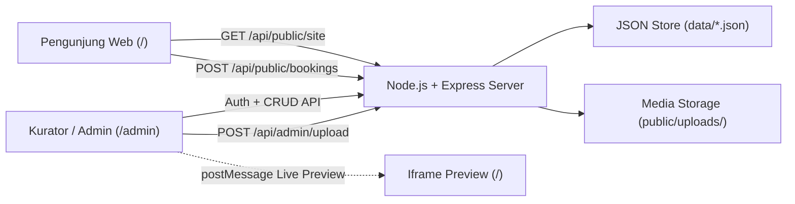

# Product Requirements Document (PRD)
## Department of Artifacts (D/A) — Web Platform & Admin Customization System

| Metadata Dokumen | Detail |
| :--- | :--- |
| **Kode Dokumen** | `FORM D/A-PRD-01` |
| **Versi** | `1.0 (MVP + Roadmap Fase 2)` |
| **Tanggal** | 22 November 2026 |
| **Status** | Aktif / Siap Eksekusi |
| **Produk** | Web Portofolio, Booking Dokumenter & Panel Admin Kustomisasi D/A |

---

## 1. Ringkasan Eksekutif & Visi Produk

**Department of Artifacts (D/A)** adalah studio fotografi dokumenter yang melayani kategori **Wisuda**, **Wedding**, dan **Event** dengan karakter visual *Arsip Retro 60-an Minimalis* dan pendekatan fotografi yang jujur, hangat, serta *candid*.

Produk ini bertujuan menyediakan:
1. **Website Publik (`/`)** yang merepresentasikan identitas visual D/A secara presisi, menampilkan katalog arsip karya, klasifikasi paket layanan, alur kerja, serta formulir pengajuan jadwal yang menerbitkan nomor resi otomatis dan terhubung langsung ke WhatsApp studio.
2. **Panel Admin Kustomisasi (`FORM D/A-ADM` di `/admin`)** yang memungkinkan pengelola studio mengubah konten, harga paket, foto portofolio, warna tema, visibilitas seksi, serta mengelola pengajuan jadwal klien secara mandiri tanpa menyentuh kode sumber.

---

## 2. Latar Belakang & Pernyataan Masalah

| Masalah | Dampak | Solusi Produk |
| :--- | :--- | :--- |
| Situs awal berupa HTML statis tunggal dengan gambar *base64* berukuran ~6,5 MB | Lambat dimuat, sulit diperbarui, dan butuh edit kode setiap kali ganti harga/foto | Pisahkan aset gambar ke folder upload & gunakan arsitektur dinamis berbasis API |
| Pengajuan jadwal klien hanya disalin manual tanpa pencatatan terpusat | Risiko jadwal terlewat, tidak ada histori status klien (`BARU`, `DIKONFIRMASI`, dll.) | Backend menyimpan setiap booking dengan nomor resi otomatis (`D/A-YYYY-XXXX`) + Inbox Admin |
| Kustomisasi tampilan (warna, teks, paket, kontak) bergantung pada developer | Operasional studio lambat saat ada promo, perubahan kota/kontak, atau sesi baru | Panel Admin lengkap dengan **Pratinjau Live (Desktop/Mobile)** dan penyimpanan persisten |

---

## 3. Target Pengguna & Persona

### 3.1. Calon Klien (Pengunjung Web Publik)
- **Profil:** Wisudawan, pasangan *intimate wedding*, panitia/komunitas acara kreatif (usia 20–35 tahun).
- **Kebutuhan:** Melihat karakter visual dan *tone* foto D/A dengan cepat, memahami kisaran harga & alur kerja, serta mengajukan jadwal tanpa proses yang rumit.
- **Perilaku:** Mayoritas mengakses melalui ponsel (*mobile-first*) dari tautan bio Instagram (`@[HANDLE_IG]`).

### 3.2. Kurator / Admin Studio (Pengguna Panel Admin)
- **Profil:** Pemilik studio, fotografer utama, atau admin operasional D/A.
- **Kebutuhan:** Mengunggah foto arsip terbaru, memperbarui tarif paket, menyesuaikan informasi kontak/kota, mengubah tampilan/tema, serta memantau dan menindaklanjuti pengajuan jadwal yang masuk.

---

## 4. Ruang Lingkup Produk

### Fase 1 — MVP (Tersedia Saat Ini)
- Web publik dinamis yang merender seluruh konten dan variabel tema dari API.
- Katalog Arsip dengan filter kategori dinamis dan *Lightbox Modal* catatan lapangan.
- Katalog Layanan & Paket dengan penanda paket unggulan (*featured*) dan tombol pintasan ke formulir booking.
- Formulir pengajuan jadwal dengan penyimpanan ke server, resi otomatis, tombol **Salin Ringkasan**, dan **Kirim ke WhatsApp (`wa.me`)**.
- Panel Admin terlindungi kata sandi (`scrypt` + token sesi) dengan 8 modul:
  1. `00 · Ringkasan` (Statistik & pengajuan terbaru)
  2. `01 · Identitas & Kontak`
  3. `02 · Tampilan & Warna` (Color picker, 4 preset tema, radius sudut, toggle visibilitas seksi)
  4. `03 · Hero & Alur Kerja` (Copywriting, upload foto hero, tahapan proses, *brand voice*)
  5. `04 · Katalog Arsip` (CRUD, urutkan, visibilitas, upload foto JPG/PNG/WEBP)
  6. `05 · Layanan & Paket` (CRUD paket & daftar *add-ons* booking)
  7. `06 · Pengajuan Masuk` (Filter status, ubah status, catatan internal, hapus)
  8. `07 · Pengaturan` (Ganti kata sandi, Ekspor/Impor JSON, Reset bawaan D/A)
- **Pratinjau Live** (*iframe* Desktop & Mobile) yang menampilkan perubahan secara *real-time* sebelum disimpan.

### Fase 2 — Iterasi Berikutnya (Roadmap)
- **Galeri Klien Privat (`/galeri/:kode`)**: Akses galeri foto per klien menggunakan kode akses unik (selaras dengan *brand voice*: *"Berkas artefak Anda telah kami arsipkan. Kode akses terlampir."*), lengkap dengan unduh satuan/ZIP dan pilihan favorit klien.
- **Multi-Foto per Berkas Arsip**: Setiap kartu arsip dapat memuat 5–15 foto dalam satu cerita dokumenter (*editorial story view*).
- **Kalender Ketersediaan Jadwal**: Admin dapat menandai tanggal penuh (*booked/blocked*) sehingga tanggal tersebut tidak dapat dipilih di formulir publik.
- **Generator Lembar Paket / Invoice PDF (`FORM D/A-PKT`)**: Ekspor otomatis lembar penawaran/invoice berstempel `DIARSIPKAN` dari data pengajuan klien.
- **Optimasi & Watermark Otomatis**: Kompresi gambar otomatis ke WebP + opsi pembubuhan watermark `D/A · XXXX` saat unggah di Panel Admin.
- **Migrasi Infrastruktur Produksi**: Pindah dari JSON lokal ke SQLite/PostgreSQL serta penyimpanan media ke Cloudflare R2 / AWS S3.

---

## 5. Kebutuhan Fungsional (Functional Requirements)

| ID | Modul | Deskripsi Kebutuhan | Prioritas | Status |
| :--- | :--- | :--- | :---: | :---: |
| **FR-01** | Web Publik | Sistem menampilkan seluruh konten (Hero, Arsip, Layanan, Proses, Booking, Footer) secara dinamis dari `/api/public/site`. | P0 | Selesai |
| **FR-02** | Tema Dinamis | Sistem menerapkan variabel CSS (`--cream`, `--paper`, `--ink`, `--orange`, `--blue`, `--yellow`, `--radius`) secara langsung dari konfigurasi admin. | P0 | Selesai |
| **FR-03** | Katalog Arsip | Pengunjung dapat memfilter arsip berdasarkan kategori dan membuka modal detail (foto besar, lokasi, catatan teknis cahaya, tombol ajukan kategori). | P0 | Selesai |
| **FR-04** | Booking & Resi | Pengunjung dapat mengirim formulir pengajuan jadwal; sistem memvalidasi input, menyimpan ke backend, dan menerbitkan kode resi `D/A-YYYY-XXXX`. | P0 | Selesai |
| **FR-05** | Integrasi WhatsApp | Setelah resi terbit, pengunjung dapat menyalin ringkasan teks atau langsung membuka tautan `https://wa.me/{nomor}?text=...`. | P0 | Selesai |
| **FR-06** | Autentikasi Admin | Panel `/admin` mewajibkan login kata sandi (hash `scrypt`) dengan sesi token berbatas waktu (24 jam) serta fitur ganti kata sandi. | P0 | Selesai |
| **FR-07** | Kustomisasi Konten | Admin dapat mengubah identitas merek, kontak, hero, tahapan proses, dan kutipan *brand voice*, lalu menyimpannya secara persisten. | P0 | Selesai |
| **FR-08** | Manajemen Media | Admin dapat mengunggah gambar (JPG/PNG/WEBP, maks 10 MB) untuk Hero maupun Katalog Arsip melalui `/api/admin/upload`. | P0 | Selesai |
| **FR-09** | CRUD Arsip & Paket | Admin dapat menambah, mengubah, menghapus, mengurutkan arsip, serta mengelola paket layanan dan *add-ons* formulir. | P0 | Selesai |
| **FR-10** | Inbox Pengajuan | Admin dapat melihat daftar booking masuk, memfilter berdasarkan status (`BARU`, `DIKONFIRMASI`, `SELESAI`, `DIBATALKAN`), memperbarui status, dan menyimpan catatan internal. | P0 | Selesai |
| **FR-11** | Pratinjau Live | Admin dapat melihat pratinjau perubahan (termasuk yang belum disimpan) dalam tampilan Desktop dan Mobile melalui `postMessage`. | P1 | Selesai |
| **FR-12** | Backup & Reset | Admin dapat mengekspor konfigurasi ke file JSON, mengimpor JSON, atau mereset seluruh situs kembali ke standar D/A. | P1 | Selesai |
| **FR-13** | Galeri Klien Privat | Klien dapat membuka galeri foto pribadinya menggunakan nomor arsip + PIN akses. | P2 | Roadmap |
| **FR-14** | Kalender Tanggal | Admin dapat memblokir tanggal yang sudah penuh agar tidak bisa diajukan oleh klien baru. | P2 | Roadmap |

---

## 6. Kebutuhan Non-Fungsional (Non-Functional Requirements)

- **Identitas Visual (`FORM D/A-01`):**
  - Proporsi warna bawaan: **60% Krem Berkas (`#F3E9D2`)**, **20% Cokelat Tinta (`#24140C`)**, **12% Oranye Arsip (`#E0561B`)**, **8% Biru Kosmik (`#1D4E9E`) & Kuning Sinyal (`#E8B53A`)**.
  - Tipografi wajib: `Space Grotesk` (judul & wordmark) dan `IBM Plex Mono` (teks isi, metadata, kode form, watermark).
  - Kontras teks utama minimal WCAG AA/AAA (`>= 7:1` pada kombinasi `#24140C` di atas `#F3E9D2`).
  - Singkatan resmi hanya `D/A` atau `DEPT. OF ARTIFACTS` (dilarang menggunakan *DOA*).
- **Performa:**
  - Waktu muat awal halaman publik `< 1,5 detik` pada jaringan 4G (gambar dimuat *lazy loading* dan terpisah dari dokumen HTML).
- **Responsivitas:**
  - Tampil optimal pada layar Desktop (`>= 1120px`), Tablet (`768px–1024px`), dan Mobile (`360px–680px`).
- **Keamanan:**
  - Kata sandi disimpan dalam bentuk *salted scrypt hash* (tidak pernah *plaintext*).
  - Validasi tipe MIME & batas ukuran 10 MB pada unggah gambar.
  - Seluruh output dinamis di-*escape* terhadap XSS.
  - Penulisan file data menggunakan mekanisme *atomic write* (`.tmp` -> `rename`).

---

## 7. Arsitektur Teknis & Alur Sistem

### Struktur Penyimpanan Data (MVP)
- `data/site-config.json` — Konfigurasi merek, tema, visibilitas seksi, hero, arsip, layanan, alur kerja, dan formulir booking.
- `data/bookings.json` — Daftar berkas pengajuan klien beserta status dan catatan internal admin.
- `data/auth.json` — *Salt* dan *hash* kata sandi admin.
- `public/uploads/` — File foto hasil unggahan admin.

### Ringkasan Endpoint API
- **Publik:** `GET /api/public/site`, `POST /api/public/bookings`
- **Auth Admin:** `POST /api/admin/login`, `POST /api/admin/logout`, `GET /api/admin/me`, `POST /api/admin/password`
- **Admin CMS:** `GET /api/admin/site`, `PUT /api/admin/site`, `POST /api/admin/site/reset`, `POST /api/admin/upload`
- **Admin Booking:** `GET /api/admin/bookings`, `PATCH /api/admin/bookings/:id`, `DELETE /api/admin/bookings/:id`

---

## 8. Metrik Keberhasilan (KPI)

| Metrik | Target | Cara Pengukuran |
| :--- | :--- | :--- |
| **Conversion Rate Pengajuan** | `>= 5%` dari pengunjung ke submit formulir | Rasio kunjungan unik vs total booking masuk di `bookings.json` |
| **Waktu Pembaruan Konten Admin** | `< 2 menit` untuk menambah arsip atau ubah harga | Uji operasional langsung melalui Panel Admin |
| **Waktu Respon Booking** | `< 2 jam` pada jam kerja (`09.00–20.00 WIB`) | Selisih `createdAt` vs `updatedAt` status `DIKONFIRMASI` |
| **Kecepatan Muat Halaman (LCP)** | `< 2,5 detik` | Pengukuran Lighthouse / Chrome DevTools pada mode Mobile |

---

## 9. Risiko & Mitigasi

| Risiko | Dampak | Mitigasi |
| :--- | :--- | :--- |
| Admin lupa mengganti kata sandi bawaan (`da-admin-2026`) saat *deploy* | Akses panel admin rentan | Tampilkan pengingat perubahan kata sandi & dukung variabel lingkungan `DA_ADMIN_PASSWORD` |
| File foto yang diunggah terlalu besar (5–10 MB per foto) | Halaman katalog menjadi lambat di ponsel | Fase 1: batas 10 MB + `loading="lazy"`. Fase 2: kompresi otomatis ke WebP (`sharp`) |
| Kehilangan konfigurasi akibat salah edit | Tampilan situs rusak | Tersedia fitur **Ekspor/Impor JSON** dan tombol **Reset ke Bawaan D/A** |
| Server di-*restart* menghapus sesi login di memori | Admin perlu login ulang | Diterima untuk MVP; pada Fase 2 sesi dapat disimpan di SQLite/Redis |
